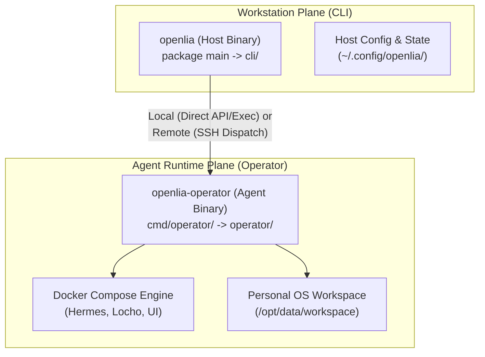

# OpenLia Go Architecture & Developer Guide

Welcome to the OpenLia Go codebase! This document provides an architectural overview, directory tour, execution flow, and step-by-step instructions for contributing to the Go packages.

---

## Architecture Overview

OpenLia is organized into two primary execution planes:



1. **Host Workstation (`cli/`)**:
   - The user-facing tool installed on macOS or Linux workstations.
   - Handles terminal UI, interactive confirmation prompts, local git hooks, Age encryption key management, and dispatching commands either locally or over SSH to remote VMs.
2. **Agent Operator (`operator/`)**:
   - The standalone administrative layer that executes on the machine where Hermes Agent and Docker Compose run.
   - Responsible for atomic profile syncs, tar/age backup creation and extraction, safe file migrations, secret injection, and container lifecycle.

---

## Directory & Package Map

| Path | Package | Purpose |
| :--- | :--- | :--- |
| `main.go` | `main` | Embeds release assets (dist, docker, workspace templates) and delegates to `cli.Run`. |
| `cmd/operator/` | `main` | Entrypoint for the standalone Linux `openlia-operator` binary; delegates to `operator.Run`. |
| `cli/` | `cli` | CLI commands, flag parsing, SSH/Local deployment dispatch, interactive terminal flows. |
| `cli/cmd_*.go` | `cli` | Domain-specific CLI handlers (`cmd_backup.go`, `cmd_skills.go`, `cmd_workspace_migrate.go`). |
| `operator/` | `operator` | Core operational plane: Compose management, backups, status, migrations, file locks. |
| `operator/backup*.go` | `operator` | Modular backup subsystem: `backup.go` (orchestrator), `backup_archive.go` (tar/zip), `backup_prune.go` (retention). |
| `operator/migration/` | `migration` | SQLite-backed migration ledger for personal workspace imports and git diff review loops. |
| `internal/` | `internal` | Private packages shared across packages: `awscredentials`, `errors`, `toolcatalog`. |

---

## How CLI Dispatch Works

When a user runs `openlia <command> [subcommand]`:

1. `main.go` calls `cli.Run(os.Args[1:], releaseAssets)`.
2. `cli.splitCommonFlags()` parses global flags (`--json`, `--non-interactive`, `--help`).
3. Root command router delegates to the appropriate command handler:
   * `cli/cmd_backup.go`: `commandBackup`
   * `cli/cmd_skills.go`: `commandSkills`
   * `cli/cmd_workspace_migrate.go`: `commandWorkspaceMigrate`
   * `cli/commands.go`: `commandInit`, `commandHealth`, `commandLifecycle`, etc.
4. If targeting a remote deployment, `deployment.operation(ctx, ...)` executes `openlia-operator` over SSH using JSON-RPC-like envelope parsing. If targeting a local deployment, `operator.RunContext` is called directly.

### Workspace-folder migration data flow

The workspace-folder migration path is separate from bundled-skill migration:

```text
openlia workspace migrate <folder>
        |
        | archive/upload and migration ID
        v
openlia-operator
        |
        +-- source manifest and eligibility scan
        +-- migration.sqlite (sources, jobs, revisions, feedback, apply journal)
        +-- proposal-repo (baseline and per-job Git checkpoints)
        +-- Hermes request runner (one source job at a time)
        |
        v
Workspace UI -> Migration
        |
        +-- inspect sources, progress, findings, and Git diffs
        +-- submit feedback, stop/resume, discard
        +-- approve an exact revision
        v
operator apply -> live workspace
```

Schema-v2 migration state is persisted under the deployment's
`.openlia/workspace-migrations/<migration-id>/` directory. The proposal
repository is not the live workspace repository: it captures a baseline,
records cumulative Hermes changes as checkpoints, and supplies immutable
revision diffs. Applying a revision requires its revision/patch identity and
checks the live hashes of affected paths before writing.

The intake layer records relative paths, hashes, encoding, detected type,
eligibility, reasons, and hledger/Remind include dependencies. It blocks
detected credentials and excludes generated/VCS material and unsupported
binary inputs. Hermes receives source content as data and may update multiple
proposal files, but imported instruction-looking files do not replace the
active workspace policy. The UI reads the same persisted records and proposal
Git history; it is not a second worker-owned review store.

There are two compatibility paths in the current code. The folder entrypoint
initializes and starts schema-v2 processing. The older `upload`/`merge`
commands use the legacy status/plan/chunk flow and should not be described as
equivalent to exact-revision schema-v2 review. Keep migration documentation
explicit about which path a command uses.

---

## Guide: How to Add a New CLI Command

To add a new subcommand (e.g., `openlia analytics`):

### 1. Register the Command in `cli/commands.go`
In `cli/commands.go`, add your command to the `switch remaining[0]` in `Run()`:
```go
case "analytics":
    return commandAnalytics(options, remaining[1:])
```

### 2. Implement the Handler in `cli/cmd_analytics.go`
Create `cli/cmd_analytics.go`:
```go
package cli

import (
    "fmt"
)

func commandAnalytics(options Options, args []string) int {
    if len(args) == 0 {
        return fail(options, ExitUsage, "analytics requires summary or export", nil)
    }
    // Handle command logic
    return writeResult(options, map[string]any{"ok": true}, "analytics complete")
}
```

### 3. Add Automated Tests
Add test cases in `cli/commands_test.go` checking exit codes and output formatting:
```go
func TestAnalyticsCommand(t *testing.T) {
    code := Run([]string{"analytics"}, fstest.MapFS{})
    if code != ExitUsage {
        t.Fatalf("expected ExitUsage, got %d", code)
    }
}
```

---

## Testing & Quality Conventions

* **Fast Unit Tests**: Run `go test ./...` (or `make test-go`). Tests must be deterministic and never require external network or cloud credentials.
* **Hermetic Mocks**:
  * Use `fstest.MapFS{}` for simulating embedded release assets.
  * Use `recordedRunner` in tests for verifying command execution without touching Docker or SSH.
* **Security & Path Traversals**:
  * Never blindly construct file paths from user inputs. Always use `safeComponent()` or `filepath.Clean()`.
  * Validate that file operations stay within the expected workspace or backup boundaries.
