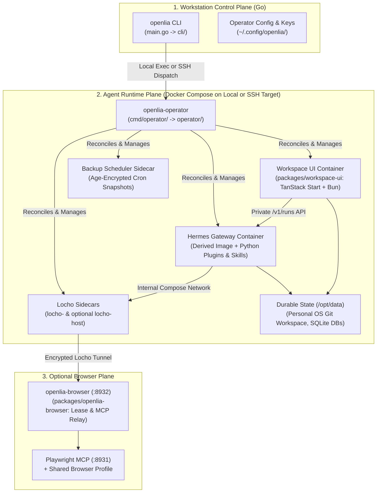

# OpenLia System Architecture & Codebase Tour

> A full-stack guide to the OpenLia repository, execution planes, and components for developers and contributors.

[← Back to Documentation Index](README.md)

Welcome to the OpenLia codebase! OpenLia is an opinionated personal operating system and operations layer built around [Hermes Agent](https://hermes-agent.nousresearch.com/). It combines a **Go control plane**, **TypeScript/Bun web and browser services**, **Python Hermes plugins and workflow skills**, and a **schema-validated Markdown workspace**.

---

## 1. High-Level System Architecture

OpenLia is split into two primary execution planes (plus an optional Browser Host plane):



1. **Workstation Control Plane (`cli/`)**:
   - The user-facing `openlia` binary installed on macOS or Linux workstations.
   - Embeds the compiled web/browser distributions, Dockerfiles, profile templates, and Linux operator binaries via `//go:embed` in `main.go`.
   - Manages `~/.config/openlia/config.toml`, protected `.env` files, and the private Age recovery key (`backup-identity.txt`).
   - Executes operations directly on local installations (`operator.RunContext`) or uploads and invokes `openlia-operator` over SSH on remote Linux targets.
2. **Agent Runtime Plane (`operator/` + `docker/`)**:
   - **`openlia-operator`**: Standalone Linux binary (`amd64` / `arm64`) that executes atomic profile synchronization, secret rotation, tar+Age backup creation/restoration, workspace folder migrations, and Docker Compose orchestration on the target machine.
   - **Hermes Container**: Pinned `hermes-agent` base image extended with `bun`, `uv`, `hledger`, Poppler, `yt-dlp`, OpenLia Python plugins, and bundled skills.
   - **Workspace UI Container**: Single Bun process serving the React/TanStack Start web app, document editor, OpenUI Mini-Projects, and native Chat proxy.
3. **Browser Plane (`packages/openlia-browser/`)**:
   - Supervises a host-local Playwright MCP process (`127.0.0.1:8931`) and exposes a Streamable HTTP `/mcp` relay (`127.0.0.1:8932`) with FIFO workflow leases and idempotency checks.

---

## 2. Repository Directory Map

| Path | Language / Tech | Purpose |
| :--- | :--- | :--- |
| [`main.go`](../main.go) | Go | Root entrypoint; embeds release assets (`//go:embed`) and calls `cli.Run`. |
| [`cli/`](../cli) | Go | Workstation CLI commands, flag parsing, SSH/local dispatch, interactive prompts. |
| [`cmd/operator/`](../cmd/operator) | Go | Entrypoint for the cross-compiled Linux `openlia-operator` target binary. |
| [`cmd/release-manifest/`](../cmd/release-manifest) | Go | Code generator synchronizing `release/manifest.json` pins across Go, Docker, TS, and docs. |
| [`operator/`](../operator) | Go | Core target operational plane: Compose lifecycle, backups, skill/instruction provenance, migrations. |
| [`operator/migration/`](../operator/migration) | Go | SQLite-backed schema-v2 workspace folder migration engine and Git proposal runner. |
| [`internal/`](../internal) | Go | Shared internal packages: `awscredentials`, `errors`, `releaseinfo`, `toolcatalog`. |
| [`packages/workspace-ui/`](../packages/workspace-ui) | TypeScript / React / Bun | Workspace UI (Documents, Native Chat, Mini-Projects, Migration, Usage, Git Checkpoints). |
| [`packages/openlia-browser/`](../packages/openlia-browser) | TypeScript / Node / Bun | Playwright MCP supervisor and lease-enforcing Streamable HTTP `/mcp` relay. |
| [`profile/`](../profile) | YAML / Markdown / Python | Hermes profile config (`config.yaml`, `SOUL.md`, `AGENTS.md`), plugins, bundled skills, system skills. |
| [`features/`](../features) | YAML / Markdown / Python | Self-contained À La Carte Feature Packages (`personal-finance`, `personal-health`, etc.). |
| [`workspace-template/`](../workspace-template) | Markdown / JSON Schema | Starter Personal OS directory structure (Lean Productivity Base) and JSON Schemas. |
| [`docker/`](../docker) | Dockerfile / Shell / Python | Derived Hermes image, Workspace UI image, Locho image, backup scheduler, and Compose stack. |
| [`examples/locho/`](../examples/locho) | TOML / Env | Example Locho attachment and relay configuration templates. |
| [`release/manifest.json`](../release/manifest.json) | JSON | Single source of truth for OpenLia, Hermes Agent, and Locho version/digest pins. |
| [`tests/`](../tests) | Python | Smoke runner (`smoke.py`), skill verifier, template validator, and plugin unit tests. |

---

## 3. Go Control Plane & Operator (`cli/` & `operator/`)

### How CLI Dispatch Works
When a user runs `openlia <command> [subcommands]`:
1. `main.go` embeds the release payload and invokes `cli.Run(os.Args[1:], releaseAssets)`.
2. `cli.splitCommonFlags()` extracts global flags (`--json`, `--non-interactive`, `--release`, `--follow`, `--check-providers`, `--help`).
3. The command switch in [`cli/commands.go`](../cli/commands.go) routes to domain handlers:
   - `cli/commands.go`: `init`, `status`, `doctor`, `deploy`, `start`, `stop`, `restart`, `uninstall`, `logs`, `update`, `auth`, `attachments`, `instructions`, `workspace-ui`, `locho-host`
   - `cli/cmd_backup.go`: `backup` (`create`, `keygen`, `status`, `list`, `push`, `restore`, `rollback-restore`, `schedule`)
   - `cli/cmd_skills.go`: `skills` (`list`, `show`, `status`, `fork`, `test`, `migrate`)
   - `cli/cmd_features.go`: `features` (`list`, `install`, `package`, `import`)
   - `cli/cmd_workspace_migrate.go`: `workspace migrate` (`list`, `status`, `monitor`, `stop`, `resume`, `discard`, `diff`, `approve`)
   - `cli/openlia_browser.go`: `browser` (`configure`, `install`, `start`, `stop`, `restart`, `status`, `logs`, `uninstall`)
   - `cli/telegram.go`: `telegram id`
4. For a **local deployment**, the CLI invokes `operator.RunContext` directly in-process. For a **remote SSH deployment**, `deployment.operation(ctx, ...)` invokes `openlia-operator` on the remote host over SSH and parses its structured JSON envelope.

### Guide: How to Add a New CLI Command
To add a new subcommand (for example, `openlia analytics`):

1. **Register the command in [`cli/commands.go`](../cli/commands.go)**:
   ```go
   case "analytics":
       return commandAnalytics(options, remaining[1:])
   ```
2. **Implement the handler in `cli/cmd_analytics.go`**:
   ```go
   package cli

   func commandAnalytics(options Options, args []string) int {
       if len(args) == 0 {
           return fail(options, ExitUsage, "analytics requires summary or export", nil)
       }
       return writeResult(options, map[string]any{"ok": true}, "analytics complete")
   }
   ```
3. **Add unit tests in [`cli/commands_test.go`](../cli/commands_test.go)**:
   Use `fstest.MapFS{}` and `recordedRunner` so tests remain fast, deterministic, and independent of Docker or SSH:
   ```go
   func TestAnalyticsCommand(t *testing.T) {
       code := Run([]string{"analytics"}, fstest.MapFS{})
       if code != ExitUsage {
           t.Fatalf("expected ExitUsage, got %d", code)
       }
   }
   ```

---

## 4. TypeScript & Bun Packages (`packages/`)

### A. Workspace UI (`packages/workspace-ui/`)
The Workspace UI is a React client and Bun HTTP server built with **TanStack Start**, **TanStack Router**, **TanStack Query**, **Tailwind CSS**, and **DaisyUI**.

- **Explicit `WorkspaceApi` Boundary**: The frontend communicates through a typed API interface (`src/client/`). Running `bun run dev` uses an in-memory mock (`mockApi.ts`) with switchable scenarios (`?scenario=auth|conflict|empty|error|loading`), allowing rapid UI work without Docker, Go, or Hermes.
- **Real Bun Server (`src/server/`)**: Running `bun run dev:real` starts Vite alongside the real Bun filesystem server against `.dev-workspace/`. In production (`dist/server.js`), one Bun process serves SSR routes, static assets, `/health`, and `/api/*`.
- **Key Subsystems**:
  - **Documents & Memory Editor**: File tree explorer, Markdown preview/editor, CodeMirror syntax editor, advisory JSON Schema validation, and optional Hermes `USER.md` / `MEMORY.md` editing with file lock coordination.
  - **Native Chat (`/chat`)**: Connects to Hermes' private `/v1/runs` API using server-side credentials (`api-server.env`) and stores session lineage/idempotency metadata in `chat.sqlite`.
  - **Mini-Projects (`/projects/<path>`)**: Renders interactive domain dashboards defined by `project-manifest.toml` and `ui.openui`, including the `hledger` financial overview, Sankey cashflow diagram, and isolated `hledger check` verification endpoint.
  - **Migration (`/migration`) & Usage (`/usage`)**: Reads `migration.sqlite` proposal repositories and `usage.sqlite` LLM telemetry.

See [`packages/workspace-ui/README.md`](../packages/workspace-ui/README.md) for frontend commands and Playwright screenshot suites.

### B. OpenLia Browser (`packages/openlia-browser/`)
`openlia-browser` supervises a host-local Playwright MCP process and exposes a Streamable HTTP `/mcp` relay on loopback (`127.0.0.1:8932`):
- **Single-Owner FIFO Leases**: Because the browser uses one shared authenticated profile, workflows must acquire a lease via `openlia_browser_session_request` and pass `lease` on every tool call.
- **Conservative Eager Allowlist**: Filters `tools/list` and blocks arbitrary JS evaluation, file upload, network inspection, and console access by default.
- **Mutating Call Idempotency**: Requires a caller-supplied `operation_id` on mutating tools (`browser_click`, `browser_type`, etc.) to prevent duplicate clicks/submissions on retry.

See [`packages/openlia-browser/README.md`](../packages/openlia-browser/README.md) for full details.

---

## 5. Hermes Profile, Python Plugins & Docker Runtime

### Derived Hermes Container (`docker/Dockerfile`)
OpenLia does not fork Hermes Agent. Instead, `docker/Dockerfile` starts from the pinned upstream `nousresearch/hermes-agent` image and installs:
- Pinned `bun` and `uv` binaries (`docker/install-tools.sh`).
- System utilities for deterministic workflows: `git`, `hledger`, `poppler-utils`, `ffmpeg`, `yt-dlp`.
- `docker/openlia_link_rewriter.py`: Rewrites workspace and memory references into clickable Workspace UI URLs.
- `docker/secret-source.sh`: Validates and supplies runtime secrets to Hermes via `secrets.command` without persisting secrets in container image layers or Compose files.

### Bundled Python Plugins (`profile/plugins/`)
Located under `profile/plugins/` and enabled in `profile/config.yaml`:

| Plugin | Purpose |
| :--- | :--- |
| **`openlia-ingestion`** | Durable background ingestion queue (`SQLite`) supporting text, PDF, images (vision LLM), Excel, CSV, and YouTube transcripts. Writes immutable artifacts to `sources/` and intake notes to `inbox/ingestion/`. |
| **`openlia-policy`** | Enforces `/opt/data/permissions.yaml` and `assistant-policy.yaml` approval gates, and bridges structural checks with Workspace Maintainer. |
| **`openlia-usage`** | Polls Hermes session/task usage, imports ingestion and migration usage handoffs into `/opt/data/usage/usage.sqlite`, and resolves model pricing. See [LLM Usage Monitoring](usage-monitoring.md). |
| **`openlia-workspace-git`** | Captures frozen workspace diff snapshots under `.git/openlia-checkpoints` and generates grouped commit proposals for user review in Workspace UI. |

---

## 6. Workspace Template & Feature Packages

### Workspace Folder Migration Data Flow
The schema-v2 workspace folder migration (`openlia workspace migrate <folder>`) runs in an isolated proposal repository before touching `/opt/data/workspace`:

```text
openlia workspace migrate <folder>
        |
        v
openlia-operator (operator/migration/)
        +-- intake scan (blocks secrets/traversal, detects types & hledger/Remind includes)
        +-- migration.sqlite (sources, jobs, revisions, feedback, apply journal)
        +-- proposal-repo (baseline & cumulative per-job Git checkpoints)
        +-- Hermes runner (processes one eligible source job at a time)
        |
        v
Review in Workspace UI (/migration) or CLI (openlia workspace migrate diff/approve)
        |
        v
Transactional apply -> live workspace (verifies live file hashes & records rollback journal)
```

### Lean Base (`workspace-template/`) & Features (`features/`)
- **`workspace-template/`**: Seeded once on `openlia init` into `/opt/data/workspace`. Contains the Lean Productivity Base (`inbox/`, `sources/`, `goals/`, `knowledge/claims/`, `tasks/`, `calendar/`, `archive/`).
- **`features/<id>/`**: Modular À La Carte Feature Packages (`feature.yaml` + `workspace/` templates/schemas/OpenUI + `skills/`). See [Skill & Feature Package Development](skill-and-feature-development.md).

---

## 7. Release Engineering & Version Pinning

All pinned component versions and cryptographic digests live in a single source of truth: [`release/manifest.json`](../release/manifest.json).

When updating OpenLia, Hermes Agent, or Locho versions:
1. Edit [`release/manifest.json`](../release/manifest.json).
2. Run `make versions-generate` (which executes `go run ./cmd/release-manifest`).
3. Verify synchronization with `make versions-check`.

`cmd/release-manifest` automatically updates:
- `internal/releaseinfo/generated.go` (never edit manually)
- `docker/.env.example`
- `examples/profiles/dev/config.toml.example`
- `packages/workspace-ui/src/client/mockApi.ts` and `src/server/app.test.ts`
- `docs/operator-guide.md`, `examples/locho/relay.toml.example`, and `THIRD_PARTY_NOTICES.md`
