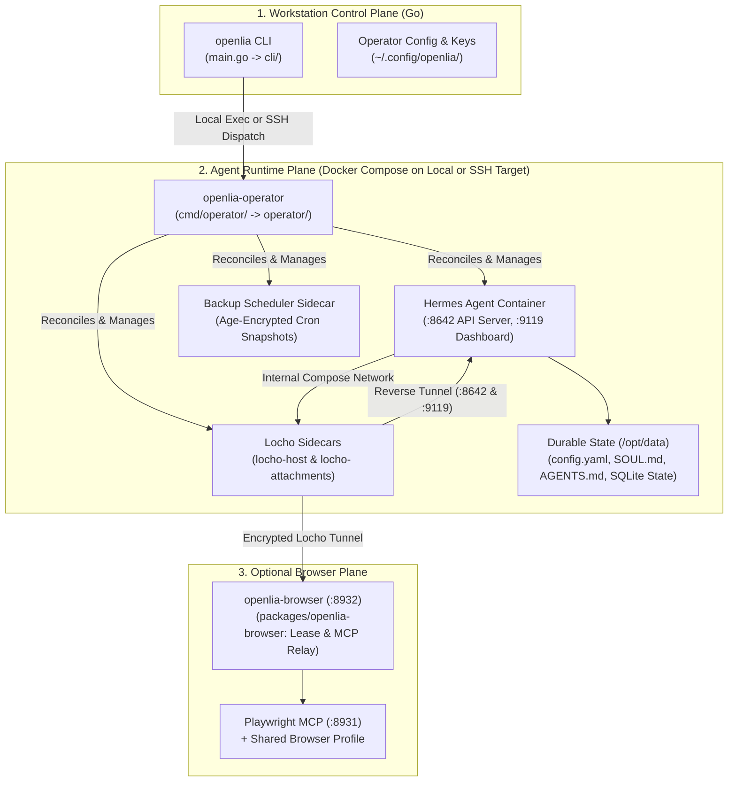

# OpenLia System Architecture & Codebase Tour

> A developer guide to OpenLia's deployment control plane, Locho tunneling, Age-encrypted backups, and Playwright MCP relay on top of [Hermes Agent](https://hermes-agent.nousresearch.com/).

---

## 1. High-Level System Architecture

OpenLia is organized around three execution planes:

1. **Workstation Control Plane (`cli/`)**:
   - The `openlia` binary run by the operator on macOS or Linux.
   - Embeds the compiled `openlia-browser` bundle, Dockerfiles, base `profile/SOUL.md` & `profile/AGENTS.md`, and cross-compiled Linux operator binaries (`dist/openlia-operator-linux-{amd64,arm64}`) via `//go:embed` in [`main.go`](../main.go).
   - Manages `~/.config/openlia/config.toml` (selectable globally via `--config <path>` or `OPENLIA_CONFIG`), protected mode-`0600` secret files (`openlia auth` / `openlia auth --oidc`), and the private Age recovery key (`backup-identity.txt`).
   - Runs operations in-process for local deployments (`operator.RunContext`) or dispatches to `openlia-operator` over SSH for remote Linux deployments.
2. **Agent Runtime Plane (`operator/` + `docker/`)**:
   - **`openlia-operator`**: Standalone Linux binary that reconciles `/opt/data/SOUL.md` and `/opt/data/AGENTS.md`, merges OpenLia's managed runtime block into `/opt/data/config.yaml`, syncs secrets and propagates Hermes API/Dashboard auth (`runtime/secrets/api-server.env`), generates Locho attachment Compose overrides, runs Age-encrypted backups and off-box S3/rsync replication, and manages Docker Compose services.
   - **Hermes Container ([`docker/Dockerfile`](../docker/Dockerfile))**: Thin wrapper over pinned upstream `nousresearch/hermes-agent` that adds pinned `bun` and `uv` runtimes plus `/usr/local/bin/openlia-secret-source` ([`docker/secret-source.sh`](../docker/secret-source.sh)), keeping upstream's s6 supervision tree (`gateway`, `api-server`, `dashboard`) intact.
   - **Locho Sidecars ([`docker/locho.Dockerfile`](../docker/locho.Dockerfile))**:
     - `locho-host`: Exposes `hermes-api` (`hermes:8642`) and `hermes-dashboard` (`hermes:9119`) to an outbound Locho relay.
     - `locho-<host>`: Connects Hermes to remote capabilities such as `openlia-browser` and `openai-gateway`.
3. **Browser Plane (`packages/openlia-browser/`)**:
   - Supervises a host-local Playwright MCP server (`127.0.0.1:8931`) and exposes a Streamable HTTP `/mcp` relay (`127.0.0.1:8932`) with single-owner FIFO workflow leases and mutating-call idempotency.

---

## 2. Repository Directory Map

| Path | Language / Tech | Purpose |
| :--- | :--- | :--- |
| [`main.go`](../main.go) | Go | Root entrypoint; embeds release assets (`//go:embed`) and calls `cli.Run`. |
| [`cli/`](../cli) | Go | Workstation CLI commands, `--config` & flag parsing, `openlia auth`, SSH/local dispatch. |
| [`cmd/operator/`](../cmd/operator) | Go | Entrypoint for the cross-compiled Linux `openlia-operator` target binary. |
| [`cmd/release-manifest/`](../cmd/release-manifest) | Go | Validator and synchronizer for `release/manifest.json` pins across Docker and Compose files. |
| [`operator/`](../operator) | Go | Target runtime orchestration: Compose lifecycle, config reconciliation, Locho attachments, Age backups. |
| [`internal/`](../internal) | Go | Shared internal packages: `awscredentials`, `errors`, `releaseinfo`. |
| [`packages/openlia-browser/`](../packages/openlia-browser) | TypeScript / Node / Bun | Playwright MCP supervisor and lease-enforcing Streamable HTTP `/mcp` relay. |
| [`profile/`](../profile) | Markdown | Base `SOUL.md` and `AGENTS.md` templates seeded into `/opt/data/` on initialization. |
| [`docker/`](../docker) | Dockerfile / Shell / YAML | Thin Hermes wrapper Dockerfile, Locho Dockerfile, backup-scheduler Dockerfile, secret-source wrapper, and Compose stack. |
| [`examples/`](../examples) | TOML / Env | Example profile configs (`examples/profiles/dev/`) and Locho attachment/relay templates (`examples/locho/`). |
| [`release/manifest.json`](../release/manifest.json) | JSON | Single source of truth for OpenLia, Hermes Agent, Locho, and Bun version/digest pins. |
| [`tests/smoke.py`](../tests/smoke.py) | Python | Operator CLI, Compose, Hermes container, and backup smoke test harness. |

---

## 3. Hermes Configuration, Profile Seeding & Dashboard Auth

- **No Forked `config.yaml`**: OpenLia does not ship a forked `profile/config.yaml`. Upstream Hermes Agent initializes `/opt/data/config.yaml` on container boot, and OpenLia's [`reconcileHermesRuntimeConfig`](../operator/profile.go) merges only the managed runtime keys:
  - `model.provider` and `model.default`
  - `secrets.command` (`enabled: true`, `command: "/usr/local/bin/openlia-secret-source"`)
  - `fallback_providers` (when configured)
  - `mcp_servers.openlia-playwright` (pointing at the active `openlia-browser` attachment sidecar)
- **Hermes API & Dashboard Environment (`api-server.env`)**:
  - [`ensureAPIServerEnv`](../operator/attachments.go) and [`RotateAuth`](../operator/auth.go) propagate `API_SERVER_KEY`, `HERMES_DASHBOARD_BASIC_AUTH_*`, `HERMES_DASHBOARD_OIDC_*`, and `HERMES_DASHBOARD_PUBLIC_URL` from `runtime/secrets/hermes.env` into `runtime/secrets/api-server.env` so upstream s6's `api-server` (`:8642`) and `dashboard` (`:9119`) services receive them via container environment.
- **Base `SOUL.md` and `AGENTS.md`**:
  - Embedded base [`profile/SOUL.md`](../profile/SOUL.md) and [`profile/AGENTS.md`](../profile/AGENTS.md) are seeded into `/opt/data/SOUL.md` and `/opt/data/AGENTS.md` if missing during initial deployment, with the managed output language block updated in `SOUL.md`.

---

## 4. Release Engineering & Version Pinning

All pinned component versions and digests live in [`release/manifest.json`](../release/manifest.json):
- `openlia`
- `hermes` (`nousresearch/hermes-agent` tag & digest)
- `locho` (`trchopan/locho` version & checksums)
- `bun` (`oven-sh/bun` version & checksums)

Run `go run ./cmd/release-manifest sync` after editing `release/manifest.json`, and verify with `go run ./cmd/release-manifest check`.
