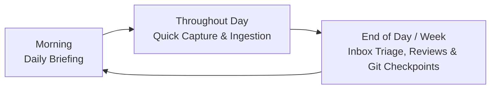

# OpenLia End User Guide

> A guide to daily life with your personal operating assistant.

[← Back to Documentation Index](README.md)

OpenLia is your **Personal Operating Assistant**—a proactive, context-aware companion designed to help you turn scattered thoughts, goals, and daily context into clear decisions and deliberate action.

---

## 1. Understanding Your Roles

When working with OpenLia, there are two distinct roles:

```text
+-------------------------------------------------------------------------+
|                            YOU (The Human)                              |
|                                                                         |
|  ┌───────────────────────────────────┐  ┌────────────────────────────┐  |
|  │        AS THE END USER            │  │      AS THE OPERATOR       │  |
|  │       (Daily Companion)           │  │   (System Administrator)   │  |
|  ├───────────────────────────────────┤  ├────────────────────────────┤  |
|  │ • Chat on Telegram or Workspace   │  │ • Runs `openlia` CLI       │  |
|  │ • Review morning briefings        │  │ • Deploys & updates server │  |
|  │ • Quick-capture notes & documents │  │ • Rotates API keys         │  |
|  │ • Track projects, goals, finances │  │ • Manages backups & health │  |
|  │ • Approve git checkpoints & plans │  │ • Installs feature packs   │  |
|  └───────────────────────────────────┘  └────────────────────────────┘  |
+-------------------------------------------------------------------------+
```

- **The End User**: The person using Lia throughout the day to organize thoughts, plan projects, track health and finances, and make decisions. **This guide is for this role.**
- **The Operator**: The person managing the underlying servers, Docker containers, API keys, and backups using the `openlia` command-line tool. If you are also managing your own server, see the [Operator Guide](operator-guide.md).

---

## 2. How You Interact With Lia

OpenLia supports multiple user interfaces depending on your preferred workflow:

### A. Workspace UI Chat (Browser Conversations)
Open the **Chat** tab at `http://localhost:8089/chat` (or your private Workspace UI address). No separate service or login is required beyond your Workspace UI session:
- Conversations and tool history are saved by Hermes and can be resumed at any time.
- Rename, pin, archive, or delete Workspace chats; other Hermes sessions (such as Telegram) are available as read-only history.
- Replies stream live with grouped tool activity, interactive approval controls, a **Stop** button, and the ability to send explicit guidance to a running agent. Navigating away or refreshing does not interrupt the running agent.
- Select a model route advertised by Hermes or leave **Hermes default** selected.
- Everyone allowed into the workspace can see its chats; these are shared workspace conversations rather than isolated per-user inboxes.

### B. Telegram (Mobile & Messaging Interface)
Telegram is the primary mobile channel for quick capture and notifications on the go:
- **Direct Messages (DMs)**: Chat one-on-one with your private bot. Send text messages, share links, upload PDFs/images/spreadsheets for durable ingestion, or record voice notes.
- **Home Channel / Group**: A dedicated Telegram channel (e.g., `"OpenLia Home"`) where Lia posts your scheduled morning briefings, automated monitor alerts, and periodic reviews.
- **Interactive Approvals**: When an action requires confirmation (such as modifying an external schedule or making a consequential change), Lia prompts you in chat before executing.

### C. Workspace UI (Documents, Projects, Git Activity & Usage)
Accessible at `http://localhost:8089` (directly on loopback, via SSH tunnel, or via a private Locho connection):
- **Documents (`/files/<path>`)**: Web-based explorer and editor for your entire personal workspace. View Markdown files with live preview, edit YAML/JSON/TOML/CSV/hledger files with syntax highlighting, and see real-time schema validation diagnostics.
- **Projects (`/projects/<path>`)**: Dedicated domain dashboards powered by `project-manifest.toml` and `ui.openui` for tasks, goals, finance (with interactive Sankey diagrams and authoritative `hledger` checks), travel, shopping, monitors, decisions, and people. See [Workspace Mini-Projects & Domain Views](workspace-domain-views.md).
- **Maintainer (`/maintainer`)**: Advisory workspace structure & schema health dashboard powered by **Workspace Maintainer**, offering guided fixes without blocking normal saves.
- **Git Activity**: Review frozen-snapshot diffs of your workspace changes and ask Lia to propose coherent commit groups (**Propose commits** → **Review & confirm** → **Confirm commits**).
- **Migration (`/migration`)**: Inspect and approve staged folder imports into your workspace.
- **Usage (`/usage`)**: Monitor estimated LLM token consumption and USD costs across Hermes, Ingestion, and Migration. See [LLM Usage Monitoring](usage-monitoring.md).

---

## 3. The Personal Workspace Model

Unlike traditional assistants where your context is locked away in vendor databases or ephemeral chat windows, OpenLia stores your life context in a **versioned, plain-text workspace** (`/opt/data/workspace`).

### Lean Productivity Base
Every new workspace starts with a focused **Lean Productivity Base**:

```text
workspace/
├── inbox/                  # Unsorted captures, links, and daily briefings
│   ├── daily-briefing/     # Dated morning briefing reports (YYYY-MM-DD.md)
│   └── ingestion/          # Durable intake records from uploaded files & links
├── sources/                # Retained original documents, extraction artifacts & manifests
│   ├── artifacts/          # Immutable extracted text/tables from ingested files
│   └── records/            # Provenance records for ingested sources
├── goals/                  # High-level outcomes and the reason they matter
├── knowledge/              # Durable notes, references, and personal claims
│   └── claims/             # Verifiable personal facts with provenance and evidence
├── tasks/                  # Concrete action items that can be completed
├── calendar/               # Event notes, meeting agendas, and reminders (reminders.rem)
└── archive/                # Completed or inactive material retained for reference
```

### À La Carte Feature Packages
Specialized life domains and workflows ship as modular **Feature Packages** that you can install on demand via the Workspace UI or `openlia features install <id>`:

| Feature Package | Workspace Folders Added | Bundled Skill / View |
| :--- | :--- | :--- |
| **`personal-finance`** | `finance/`, `finance/intake/`, `finance/accounts/`, `finance/portfolios/`, `finance/reviews/` | `personal-finance` skill + hledger dashboard & Sankey cashflow view |
| **`personal-health`** | `health/`, `health/profiles/`, `health/history/`, `health/conditions/`, `health/treatments/`, `health/reviews/` | `personal-health` skill & structured medical templates |
| **`decision-analysis`** | `decisions/` | `decision-analysis` skill + option/criteria trade-off matrix |
| **`deep-research`** | `knowledge/research/` | `deep-research` skill + source rubric & brief templates |
| **`areas`** | `areas/` | Ongoing responsibilities (career, home, family, learning) |
| **`ideas`** | `ideas/` | Idea capture and incubation records |
| **`monitors`** | `monitors/` | Watches for external changes (prices, flights, releases, feeds) |
| **`people`** | `people/` | Personal CRM, relationships, and interaction notes |
| **`shopping`** | `shopping/` | Purchase candidates, budgets, comparisons, and wishlists |
| **`travel`** | `travel/` | Trips, itineraries, reservations, and packing checklists |

### Structured Records and Schemas
Records in templated folders use standard Markdown with YAML frontmatter. Each folder's `*-template.md` declares a local `$schema` pointing to a JSON Schema file:

```markdown
---
$schema: ./goal-template.schema.json
title: Become proficient in distributed systems
status: active
target_date: "2026-12-31"
---

## Why This Matters
Build strong foundations for designing fault-tolerant services.

## Milestones
- [x] Read Designing Data-Intensive Applications
- [ ] Implement Raft consensus lab
```

Validation is **advisory**: the Workspace UI and Workspace Maintainer highlight structural or schema issues without blocking you from saving your notes. Ordinary nested folders without a local template remain free-form.

### Durable Ingestion (`sources/` & `inbox/ingestion/`)
When you send Lia a PDF, image, Excel spreadsheet, CSV, text file, or YouTube link:
1. The ingestion runtime retains the original file and extracted artifacts under `sources/`.
2. It creates a durable intake record in `inbox/ingestion/` and a source provenance record in `sources/records/`.
3. For password-protected PDFs or spreadsheets, you can store document-unlock passwords in `sources/document-passwords.toml`.

### The Claim Ledger (`knowledge/claims/`)
When you tell Lia something durable about your life (e.g., *"I am allergic to penicillin"* or *"My passport expires in June 2028"*), Lia records a structured **Claim Record** in `knowledge/claims/`:
- **Claim & Scope**: The specific statement and subject.
- **Evidence & Provenance**: References to the source message or document (`sources/records/...`).
- **Certainty & Status**: Distinguishes direct user reports from observations or inferences, and tracks `active`, `contested`, or `superseded` lifecycle states.
- **Temporal Validity**: `valid_until` and `review_after` dates so facts never silently go stale.

---

## 4. Daily Life and Review Loops

OpenLia operates on a continuous cadence, helping you stay proactive rather than reactive:



1. **Morning: The Daily Briefing (`/daily-briefing`)**
   Lia checks today's calendar (`calendar/reminders.rem` and event notes), urgent tasks, active monitors, and pending `inbox/` items, then writes a focused briefing to `inbox/daily-briefing/YYYY-MM-DD.md` and delivers a summary to chat.
2. **Throughout the Day: Frictionless Quick Capture**
   Send quick text notes, voice messages, links, or documents to Lia. When the final category is unclear, Lia captures them into `inbox/` first so you never lose context.
3. **Triage & Organization (`/inbox-triage` & `/workspace-organize`)**
   Ask *"Let's triage my inbox."* Lia reviews recent captures and proposes filing them into your goals, tasks, or installed feature domains.
4. **Periodic Reviews (`/weekly-review`, `/personal-finance`, `/personal-health`)**
   Run weekly reviews to clear stagnant tasks, reconcile financial journals in `finance/`, or review health records in `health/`.
5. **Deep Research & Decision Analysis (`/deep-research`, `/decision-analysis`)**
   When facing a major choice, ask Lia to structure the options, criteria, constraints, and evidence in `decisions/` or `knowledge/research/`.
6. **Workspace Git Checkpoints**
   Ask Lia to *"review my workspace changes and propose commits"* or click **Propose commits** in **Git Activity** in the Workspace UI. Lia groups your recent edits into logical commits with clear messages for your one-click confirmation.

---

## 5. Trust, Safety, and Approvals

OpenLia is designed around **useful autonomy with a clear human approval boundary**. Consequential runtime permissions (`/opt/data/permissions.yaml`, configurable in Workspace UI under **Configuration**) govern destructive actions (`delete_records`, `overwrite_records`), external side effects (`send_messages`, `modify_external_calendar`, `purchases`, `financial_transactions`), and scheduled work (`scheduled_work`):

| Action Category | Default Authority | Behavior |
| :--- | :--- | :--- |
| **Reading & Analyzing Workspace** | Automatic | Lia reads notes, searches files, and synthesizes answers automatically. |
| **Writing to Inbox & Daily Briefings** | Standing delegation | Lia creates daily briefings and captures incoming notes/files to `inbox/` and `sources/`. |
| **Routine Workspace Updates** | Standing delegation | Routine updates to tasks and notes within authorized domains, preserving provenance. |
| **New Recurring Workspace Structure** | Scoped confirmation | Lia designs the folder and template and offers **Confirm, Adjust, or Cancel** before applying. |
| **Workspace Git Commits** | Explicit confirmation | Lia proposes grouped commits from a frozen diff snapshot; you confirm them in the UI. |
| **External Communications (Email/Chat)** | Always ask | Lia drafts messages and waits for your explicit approval before sending. |
| **Financial Transactions & Purchases** | Always ask | Local bookkeeping (`finance/`) is separate from external money movement, which always requires approval. |
| **Destructive Actions / Deletions** | Always ask | Lia never permanently deletes records or rewrites Git history without confirmation. |
